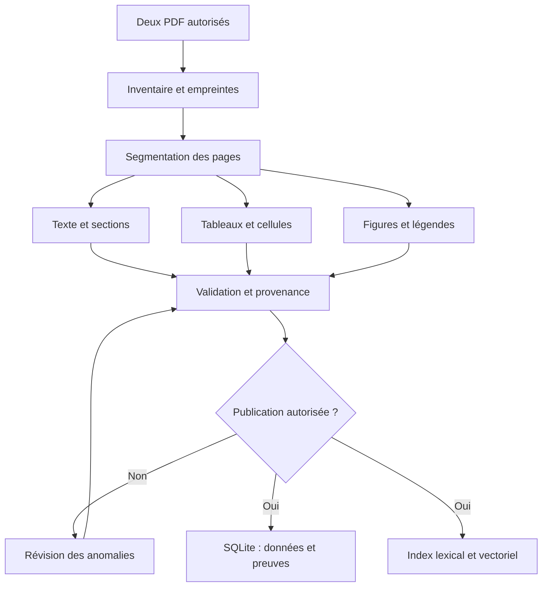
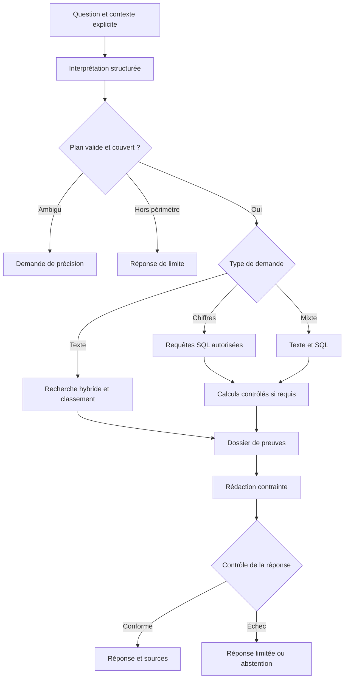

# Plan d’architecture RAG pour les deux annuaires DGRE

Version de conception — 12 septembre 2026

**Recommandation : construire un RAG documentaire et analytique, avec un parcours contrôlé, une base numérique validée et des preuves rattachées à chaque réponse.** Le LLM interprète la demande et rédige. Le logiciel sélectionne les données autorisées, exécute les calculs et contrôle les résultats.

Ce plan porte exclusivement sur les deux PDF fournis comme sources hydrologiques. Le plan de l’ami est un document à examiner, jamais une source de mesures à indexer. Les références techniques finales concernent les outils de développement et ne doivent pas entrer dans le corpus du futur assistant.

L’analyse repose sur l’extraction textuelle des deux PDF, la lecture ciblée de leur organisation et des tableaux représentatifs, et l’inspection visuelle de plusieurs pages complexes. Elle ne constitue pas une validation exhaustive de toutes les cellules des 387 pages. Les propositions ci-dessous sont une architecture à implémenter, pas un système déjà développé ou testé.

## 1. Constats qui déterminent l’architecture

| Constat vérifié | Source précise | Conséquence |
|---|---|---|
| L’annuaire pluviométrique contient 242 pages PDF ; l’hydrologique, 145. | Fichiers fournis | Inventorier les 387 pages et leur état de traitement. |
| L’année hydrologique va du 1er septembre 2022 au 31 août 2023. | Pluviométrique, page PDF 2 | Septembre à décembre appartiennent à 2022 ; janvier à août à 2023. |
| Le texte distingue 726 stations observées et une sélection de 148 stations pour la description nationale. | Pluviométrique, page PDF 6, imprimée 3 | Ne pas confondre couverture annoncée, stations extraites et échantillon de synthèse. Vérifier les effectifs réellement présents. |
| Des synthèses régionales couvrent 2015-2016 à 2022-2023. | Pluviométrique, page PDF 9, imprimée 6 | La période d’une observation n’est pas l’année éditoriale du document. |
| Une page peut porter quatre tableaux annuels de stations, chacun avec son résumé. | Pluviométrique, page PDF 50, imprimée 47 | Découper la page par régions géométriques avant d’associer tableaux et totaux. |
| La fiche de Pont de Bizerte distingue un maximum journalier de 30,86 m³/s, un maximum instantané de 32,4 m³/s en juin 2023 et une crue historique de 294 m³/s en février 2012. | Hydrologique, page PDF 18, imprimée 17 | Trois indicateurs ou portées temporelles différents ; ne jamais les stocker sous un unique « débit maximal ». |
| Pont de Bizerte est classée sous Ariana dans le document. | Hydrologique, pages PDF 17–18 | Ne pas déduire le gouvernorat d’un mot contenu dans le nom de la station. L’exemple de ton ami est cohérent sur ce point. |
| Une remarque signale l’influence de pompages à cette station. | Hydrologique, page PDF 19, imprimée 18 | Rattacher les remarques qualitatives aux séries concernées. |
| Les deux ouvrages contiennent de la pluviométrie. | Hydrologique, page PDF 20 ; pluviométrique, tableaux mensuels | Chercher les doublons et divergences ; ne pas router exclusivement par titre du fichier. |

Le texte natif est disponible, mais son ordre de lecture peut mélanger les colonnes, les légendes et les résumés. La présence de texte ne garantit donc pas une extraction numérique fiable. Les numéros PDF et les numéros imprimés diffèrent : enregistrer les deux page par page.

## 2. Analyse du plan de ton ami

Le plan est une bonne base conceptuelle : séparation texte/chiffres, métadonnées, recherche hybride, citations, clarification et évaluation sont pertinents. Son point faible est le manque de contrats précis entre les composants.

| Proposition du plan | Limite | Modification recommandée |
|---|---|---|
| Chroma et SQLite | Mettre un nombre dans SQL ne prouve pas qu’il a été bien extrait. | Zone brute, zone candidate, puis publication des données validées. |
| Extraction des tableaux | Association station/cellule et tableaux multiples insuffisamment définie. | Conserver rectangle, ligne, colonne, en-têtes et identifiant du bloc. |
| Métadonnée `year` | Mélange année du PDF, période de mesure et date d’un record. | Champs temporels séparés et couverture explicite. |
| Agent de vérification avant le LLM | La rédaction peut ensuite changer un chiffre ou ajouter une conclusion. | Vérification avant et après génération. |
| Reranker après recherche et calcul | Une pertinence textuelle ne valide pas un calcul. | Reranker réservé aux passages ; contrôles déterministes pour les valeurs. |
| Prompt anti-hallucination | Une consigne ne constitue pas une garantie. | Données autorisées, validation du plan, preuves, contrôle final et abstention. |
| Description des figures par vision | Une description générée peut inventer des détails. | Séparer description candidate et fait validé ; privilégier l’affichage de l’original. |
| Routage pluie vers un seul fichier | Masque les recouvrements entre ouvrages. | Routage par indicateur, entité, période et couverture. |
| Nombreux outils d’agents | Fonctions redondantes et parcours difficiles à vérifier. | Petit ensemble d’opérations typées et un orchestrateur borné. |
| V1 robuste en quatre jours | Dépend entièrement de la qualité de l’extraction. | Quatre jours peuvent viser une démonstration limitée ; étendre selon les critères d’acceptation. |

Une base vectorielle unique avec des métadonnées correctes convient aux deux fichiers. Deux bases vectorielles séparées ne sont pas nécessaires. Un graphe de connaissances et une équipe d’agents autonomes ne sont pas requis pour ce périmètre.

## 3. Définir ce que l’assistant peut répondre

| Demande | Comportement |
|---|---|
| Explication du réseau ou d’une méthode décrite | Recherche de passages, synthèse citée. |
| Valeur par station, mois ou année disponible | Lecture de la base structurée et citation de la cellule source. |
| Différence, maximum, moyenne ou cumul | Calcul autorisé sur des observations compatibles et validées. |
| Comparaison historique présente dans un tableau | Acceptée pour les régions et périodes effectivement couvertes. |
| Comparaison entre documents | Présentation séparée des valeurs et de leur définition ; signalement des divergences. |
| Carte ou hydrogramme | Affichage de la figure ; commentaire limité à ce qui est établi. |
| Prévision de crue demain ou situation actuelle | Expliquer que ces deux annuaires ne fournissent pas les données nécessaires. |
| Décision d’évacuation, ouverture de barrage ou allocation optimale | Ne pas transformer des observations annuelles en recommandation opérationnelle non documentée. |
| SPI/SPEI ou période de retour calculés automatiquement | Désactivés tant que les séries et méthodes nécessaires ne sont pas démontrées dans le corpus et validées. |

Positionnement conseillé : **assistant d’analyse documentaire et quantitative pour contribuer à l’aide à la décision hydrologique**. Il peut documenter une situation historique, pas garantir une prédiction ou une décision avec ces seules sources.

## 4. Architecture d’ingestion — hors conversation



### 4.1 Registre des documents

Enregistrer `document_id`, nom original, empreinte SHA-256, nombre de pages, date d’ingestion, version d’extracteur et version du corpus. La liste blanche ne contient que les deux PDF. Une modification du fichier produit une nouvelle version vérifiable.

L’ingestion doit être relançable sans dupliquer les données. Une version du corpus n’est activée que lorsque la base et ses index sont construits et contrôlés ensemble.

### 4.2 Inventaire et segmentation

Créer une ligne par page : type de contenu, section, page imprimée, présence de tableaux/figures, qualité du texte, état d’extraction et anomalies. Distinguer : synthèse régionale, inventaire de stations, pluie mensuelle, pluie cumulée, jours de pluie, pluie journalière, fiche hydrométrique, débit journalier, étalonnage, crues, carte et hydrogramme.

Pour chaque tableau : localiser la zone, extraire son titre, ses en-têtes et ses notes. Gérer les tableaux poursuivis sur plusieurs pages. Ne pas transmettre aveuglément le gouvernorat ou la station de la page précédente.

### 4.3 Extraction et OCR

Tester d’abord l’extraction native avec PyMuPDF et un extracteur de structure tel que Docling sur un lot représentatif. Utiliser les positions des mots pour reconstruire les cellules des formats réguliers. Réserver OCR/vision aux régions dont l’extraction échoue ; conserver l’image de référence.

Pour la page pluviométrique 50, traiter chacun des quatre blocs indépendamment, résumé inclus. Sur la page hydrologique 18, séparer la fiche, la courbe d’étalonnage, son tableau et la matrice des débits.

Deux extracteurs concordants ne garantissent pas la vérité. Les contrôles géométriques, les totaux et la vérification humaine des cas difficiles restent nécessaires.

### 4.4 Trois états de données

1. **Brut** : texte et cellule tels qu’extraits, sans correction silencieuse.
2. **Candidat** : valeur normalisée avec indicateur, période, unité et rattachement proposé.
3. **Publié** : enregistrement ayant passé les contrôles requis, avec statut et preuves.

Les anomalies restent consultables pour l’audit. Elles ne deviennent pas automatiquement des données utilisables dans les calculs.

### 4.5 Validation obligatoire

- Codes de stations conservés comme chaînes ; ne pas tronquer un code atypique pour obtenir une longueur attendue.
- Virgules décimales normalisées sans perdre la valeur brute et sa précision.
- Distinguer zéro explicite, tiret, case vide, valeur illisible, trace éventuelle et jour inexistant.
- Un tiret n’est converti en zéro que si la convention applicable est établie. Sans preuve, conserver un statut indéterminé et bloquer les calculs qui nécessitent son interprétation.
- Construire les dates réelles : ne pas créer de 31 avril ou de 29 février 2023.
- Vérifier l’alignement des douze mois ; ne pas confondre ligne quotidienne et ligne Moy/Min/Max/Tot.
- Contrôler sommes journalières/mensuelles/annuelles, extrema et dates associées ; calculer des tolérances à partir de la précision publiée et du nombre de termes.
- Distinguer précision d’extraction, complétude de série et cohérence du document : ce sont trois dimensions différentes.
- Vérifier les coordonnées selon leur système déclaré. Des coordonnées UTM en mètres ne sont pas des degrés ; conserver `crs_unknown` si zone ou référentiel manquent. Signaler les coordonnées suspectes sans les corriger par intuition.
- Conserver séparément valeur publiée et valeur recalculée ; ne jamais remplacer l’une par l’autre pour faire disparaître un écart.

Une anomalie peut provenir de l’extraction, d’un arrondi, d’une définition différente ou de la source elle-même. Le statut doit distinguer ces cas, avec une justification révisable.

## 5. Modèle de données

SQLite conserve les informations canoniques ; l’index vectoriel conserve des représentations de recherche qui pointent vers ces informations.

| Table | Champs principaux et rôle |
|---|---|
| `documents` | Identité, empreinte, édition, nombre de pages, version. |
| `source_blocks` | Document, page PDF, page imprimée, type, rectangle, texte brut, titre, bloc parent. |
| `source_cells` | Bloc/tableau, ligne, colonne, rectangle, en-têtes, texte brut. |
| `entities` | Identifiant interne, type station/gouvernorat/région/bassin, libellé validé. |
| `entity_mentions` | Libellé/code source, document, bloc, entité candidate ou validée, statut de rapprochement. |
| `entity_relations` | Station–gouvernorat, station–bassin, région–gouvernorat, preuve et période éventuelle. |
| `metrics` | Code, définition, unité, granularité, opérations autorisées. |
| `observations` | Entité, indicateur, période début/fin, instant éventuel, valeur, unité, origine publiée/recalculée, statut. |
| `baselines` | Référence climatique, période si connue, nombre d’années, méthode et périmètre. |
| `observation_evidence` | Liens entre une observation et toutes ses cellules/blocs sources. |
| `derivations` | Formule versionnée, entrées, sortie, complétude, règle d’arrondi. |
| `quality_issues` | Type, sévérité, éléments concernés, décision, justification. |
| `coverage` | Document, entité, indicateur, période, éléments attendus/disponibles/validés. |
| `chunks` | Texte, parent, source, métadonnées, version ; support du lexical et du vectoriel. |
| `query_runs` | Demande, plan validé, identifiants de preuves, calculs, statut final, versions et durée. |

Ne pas imposer une unicité qui écrase les valeurs contradictoires. Deux affirmations différentes sur la même observation peuvent coexister avec leurs preuves. Les vues de calcul doivent sélectionner explicitement la version acceptée, sans compter deux fois un fait repris dans les deux livres.

Le rapprochement de stations exige plus que la similarité du nom : code, type de station, localisation et contexte. Deux instruments portant un nom proche ne sont pas nécessairement une même station. Une correspondance ambiguë reste non résolue.

Exemples d’indicateurs à séparer : `rainfall_daily`, `rainfall_monthly`, `rainfall_cumulative`, `rainfall_annual`, `rain_days_gt_0`, `rain_days_ge_0_5`, `rain_days_ge_10`, `discharge_daily_mean`, `discharge_annual_mean`, `discharge_daily_max`, `discharge_instantaneous_max`, `historical_flood_peak`, `runoff_volume`.

Le registre des indicateurs précise aussi l’échelle spatiale, la référence nécessaire et la distinction entre valeur publiée et calcul autorisé.

## 6. Texte, tableaux et figures dans la recherche

### Texte

Découper selon sections et paragraphes, en préservant station, gouvernorat, titre et notes. Une taille initiale de 300–700 tokens peut servir au prototype ; ce n’est pas une règle universelle. Les passages enfants servent à la recherche ; le contexte parent est ajouté dans la limite d’un budget déterminé.

Ne pas indexer les en-têtes répétitifs comme contenu métier. Ne pas mélanger deux stations dans un passage. Conserver les formulations originales et des variantes normalisées pour la recherche.

### Tableaux

Indexer un résumé descriptif : indicateurs, stations, périodes, titre et source. Les valeurs utilisées dans une réponse numérique viennent des cellules validées en SQL. Une recherche vectorielle de quelques lignes ne peut pas produire un classement exhaustif.

### Figures

Conserver image, légende, page, rectangle et liens vers les tableaux associés. Une description issue d’un modèle porte le statut `generated_unverified` tant qu’elle n’est pas validée ; elle peut aider à retrouver l’image, mais ne sert pas de preuve autonome.

Ne pas lire un débit exact sur une courbe lorsque la valeur est disponible dans un tableau. La numérisation d’un graphique, si ajoutée ultérieurement, doit produire une estimation explicitement étiquetée et contrôlée.

### Recherche hybride

Résolution exacte des codes et alias, recherche lexicale, recherche sémantique, fusion des candidats puis classement des passages. SQLite FTS5 permet une recherche lexicale avec BM25 ; un index vectoriel local peut compléter cette voie.

Point de départ expérimental : 20 candidats par voie, fusion par rang, puis 6–10 passages après classement et ajout du contexte utile. Ajuster sur les tests ; ne pas présenter ces paramètres comme optimaux avant mesure. Un score de similarité n’est pas une probabilité de vérité.

## 7. Architecture pendant une question



### 7.1 Interprétation de la question

Garder la question originale. Normaliser les variantes de noms sans modifier silencieusement période, unité ou intention. Résoudre les codes de façon déterministe et proposer des candidats en cas de proximité ambiguë.

Le contexte conversationnel peut conserver une station déjà choisie ou une période explicitement fixée. Il ne constitue jamais une nouvelle source de mesures. Une donnée fournie oralement par l’utilisateur reste hors corpus ; elle ne doit pas être présentée comme issue des annuaires.

### 7.2 Plan typé

Le LLM peut proposer un objet JSON, que le programme valide. Exemple de question : « Quel est le maximum du débit moyen journalier à Pont de Bizerte pour 2022-2023 ? »

```json
{
  "intent": "lookup",
  "entity": {"source_code": "1485900188", "kind": "hydrometric_station"},
  "metric": "discharge_daily_max",
  "period": {"start": "2022-09-01", "end": "2023-08-31"},
  "mode": "published",
  "operations": ["resolve_entity", "lookup"],
  "needs_clarification": false
}
```

Le plan validé remplace le code par l’identifiant interne résolu, sélectionne le corpus actif et contrôle entité, indicateur, unité, période et disponibilité. « Quel est le débit de Béja ? » nécessite une précision sur la station et le type de débit. « Maximum historique » ne doit pas devenir « maximum de 2022-2023 ».

### 7.3 Exécution bornée

Opérations proposées : `resolve_entity`, `search_passages`, `lookup`, `aggregate`, `compare`, `calculate`, `get_evidence`. Les opérations et formules sont dans une liste blanche.

Le LLM ne fournit ni Python libre ni SQL arbitraire. Le programme construit des requêtes paramétrées à partir du plan, avec identifiants SQL eux-mêmes validés. Connexion de consultation en lecture seule, limites de lignes et de durée. Pour les classements, calculer sur l’ensemble des lignes admissibles avant d’appliquer la limite d’affichage.

Limiter une demande, par exemple, à une reformulation de recherche et une réparation de sortie. Ces bornes sont des paramètres de conception à mesurer. En cas d’échec persistant, rendre un statut explicite ; pas de boucle indéfinie d’agents.

## 8. Règles de calcul

Une bibliothèque de formules versionnées autorise seulement les opérations dont le sens est défini. Les formules sont des règles du logiciel ; les observations et références utilisées proviennent des deux PDF.

| Calcul | Règle | Conditions |
|---|---|---|
| Différence | A − B | Même indicateur, unité, période et échelle comparable. |
| Rapport à la référence | 100 × P / R | R > 0 ; référence et portée identifiées. |
| Anomalie relative | 100 × (P − R) / R | Ne pas confondre avec le rapport à la référence. |
| Déficit exprimé positivement | 100 × (R − P) / R | Indiquer la convention ; une valeur négative signifie un excédent. |
| Cumul annuel de pluie | Somme des 12 mois | Mois complets, non déjà cumulés, qualité acceptée. |
| Débit moyen sur une période | Moyenne pondérée par les durées | Série admissible ; pondérer les moyennes mensuelles par le nombre de jours. |
| Volume à partir de débits moyens journaliers | Somme de Qj × 86 400 ; division par 10⁶ pour hm³ | Journées complètes, unité m³/s, calendrier et couverture établis. |
| Maximum observé | Maximum et toutes les dates ex æquo | Préciser journalier/instantané et couverture ; série partielle = maximum sur données disponibles. |

Ne pas sommer des millimètres entre stations pour produire une pluie de gouvernorat. Reprendre une synthèse publiée ou utiliser une méthode spatiale explicitement validée avec les poids nécessaires. Une moyenne arithmétique d’un sous-ensemble doit être nommée comme telle.

Les lignes « total », « moyenne » et les mesures élémentaires ne sont jamais cumulées ensemble. Une série cumulative n’est pas additionnée comme une série mensuelle. Le nombre de jours de pluie dépend du seuil ; ne pas déduire ce seuil du seul nom du tableau.

Si des données manquent : afficher les nombres attendu/disponible/valide et ne pas qualifier un calcul de total annuel complet. Une valeur annuelle publiée peut toutefois être citée comme telle même si la série quotidienne n’est pas encore exploitable, en séparant clairement les deux statuts.

Conserver la précision source et arrondir seulement à l’affichage. Une différence entre calcul et résumé publié déclenche une analyse d’écart, jamais une modification des entrées pour retrouver le total.

## 9. Contradictions, preuves et contrôle final

### Contradictions

Comparer seulement des faits de même indicateur, station, période, unité et définition. D’abord vérifier le PDF : une divergence peut être un mauvais rattachement de cellule. Ensuite examiner arrondis, échantillonnage et référence. Si elle demeure, conserver les deux affirmations et leurs sources ; ne pas choisir celle qui a le meilleur score vectoriel.

Une sélection de source doit être une règle documentée par indicateur ou une décision de révision tracée. À défaut, présenter le conflit et bloquer les calculs qui nécessitent une valeur unique.

### Dossier de preuves

Chaque résultat contient : identifiants d’observations ou de passages, source, page PDF et imprimée, tableau/cellule ou rectangle, unité, période, statut qualité et éventuelle formule avec ses entrées. Les citations sont produites par le programme à partir de ces identifiants ; le modèle ne crée pas de numéros de pages.

### Deux contrôles

Avant rédaction : vérifier que les preuves répondent à toute la question et que les calculs sont admissibles. Après rédaction : vérifier nombres, unités, périodes, entités et rattachement des affirmations aux preuves.

Pour les réponses numériques, favoriser un gabarit alimenté directement par les résultats. Pour les synthèses, demander au modèle des affirmations avec identifiants de preuve, puis contrôler leur support. Un éventuel juge LLM reste une aide, pas une garantie indépendante.

Une source existante ne suffit pas : elle doit soutenir l’affirmation concernée. Si une phrase ajoute une cause non documentée, la supprimer ou reformuler la réponse. Après une réparation infructueuse, renvoyer une réponse limitée aux faits validés.

Statuts utiles : `answered`, `partial`, `ambiguous`, `not_found`, `out_of_scope`, `unvalidated_data`, `source_conflict`, `technical_error`. Un incident logiciel ne doit pas être présenté comme une absence dans les livres. « Non retrouvé » ne signifie pas automatiquement « absent de tout le corpus ».

## 10. Exemple de résultat attendu

Question : « Quel est le débit maximal journalier de Pont de Bizerte en 2022-2023 ? »

Réponse attendue après ingestion validée : le maximum du débit moyen journalier publié est **30,86 m³/s**, daté du **2 juin 2023**. Source : annuaire hydrologique, page PDF **18**, page imprimée **17**, fiche de la station **1485900188**.

Le résultat ne doit pas prendre 32,4 m³/s, qui concerne le maximum instantané, ni 294 m³/s, qui concerne le record historique mentionné en 2012. Cet exemple constitue un excellent test de non-régression.

L’interface doit proposer la réponse, la période, le statut « publié » ou « calculé », les sources ouvrables, et les limites utiles. Un volet facultatif présente formule et entrées. Afficher une trace d’exécution factuelle, pas le raisonnement interne du modèle.

## 11. Stack et modules à développer

| Besoin | Choix initial proposé |
|---|---|
| Extraction native et coordonnées de page | PyMuPDF. |
| Structure des tableaux et OCR ciblé | Docling à comparer à l’extraction géométrique sur les pages difficiles. |
| Données canoniques et recherche lexicale | SQLite + FTS5. |
| Recherche sémantique | Index local, par exemple Chroma si déjà utilisé. |
| Contrats d’entrée/sortie | Schémas JSON validés, par exemple avec Pydantic. |
| Calculs | Fonctions Python déterministes, décimaux et dates contrôlés. |
| Orchestration | Workflow Python explicite ; LangGraph facultatif si ses états apportent un avantage démontré. |
| LLM et embeddings | Choix après mesure sur le matériel disponible et un jeu français représentatif. |
| Interface | Streamlit pour le prototype. |
| Tests et versionnement | pytest, Git et dépendances verrouillées. |

Aucun modèle précis ne peut être déclaré meilleur ici sans connaître la RAM/VRAM et mesurer précision, respect du JSON et temps de réponse. L’architecture permet une exécution locale. Si une API est choisie, documenter les extraits qui lui sont transmis ; ne pas modifier le périmètre des sources.

| Module | Responsabilité |
|---|---|
| `document_registry.py` | Liste blanche, empreintes et version du corpus. |
| `page_inventory.py` | Pages, numérotation, couverture et familles de mise en page. |
| `layout_extractor.py` | Blocs, tableaux, cellules, figures et coordonnées. |
| `normalizer.py` | Valeurs brutes/normalisées, unités, dates, statuts. |
| `entity_registry.py` | Stations, codes, alias et rapprochements validés. |
| `semantic_registry.json` | Indicateurs, définitions, dimensions et opérations permises. |
| `quality_validator.py` | Contrôles, anomalies et décisions de publication. |
| `stores.py` | Base SQL, index et activation cohérente des versions. |
| `retriever.py` | Lexical, vectoriel, fusion et classement des passages. |
| `query_planner.py` | Proposition du plan structuré. |
| `plan_validator.py` | Validation métier, couverture, ambiguïté et autorisations. |
| `data_engine.py` | Exécution des opérations SQL prédéfinies. |
| `formula_library.py` | Formules admissibles et traçabilité des calculs. |
| `evidence_builder.py` | Assemblage des preuves et détection des conflits. |
| `response_generator.py` | Gabarits numériques et rédaction documentaire. |
| `response_validator.py` | Contrôle final et abstention. |
| `pipeline.py` | États, budgets, reprises limitées et erreurs explicites. |
| `evaluation.py` | Jeu annoté, métriques et analyse des échecs. |

Ces fichiers peuvent rester dans une seule application. Leur séparation définit les responsabilités, sans nécessiter des services déployés séparément.

## 12. Plan de réalisation avec critères de passage

Estimations indicatives pour une personne, à réviser après le pilote d’extraction ; elles ne sont pas une promesse de délai.

| Phase | Travail et livrable | Condition pour poursuivre | Effort indicatif |
|---|---|---|---|
| 1. Cadrage | Questions autorisées, inventaire des pages, premiers cas de test. | Périmètre, périodes et types d’indicateurs explicites. | 1–2 jours |
| 2. Pilote d’extraction | Lot de 15–25 pages couvrant toutes les familles connues. | Rattachement station/cellule correct sur le lot relu ; ambiguïtés enregistrées. | 3–5 jours |
| 3. Base validée | Schéma SQL, dates, unités, provenance, conflits et couverture. | Aucun enregistrement publié sans source ; aucune anomalie bloquante ignorée. | 3–5 jours |
| 4. Recherche | Texte structuré, lexical, vecteurs et comparaison des méthodes. | Mesures satisfaisantes sur les questions documentaires annotées. | 2–3 jours |
| 5. Questions numériques | Plan, validation, requêtes et formules. | Cas limites de calendrier, zéro, cumul, maxima et références réussis. | 3–4 jours |
| 6. Réponses | Preuves, génération, contrôle final et interface. | Valeurs et citations correctes sur les tests de bout en bout. | 2–3 jours |
| 7. Extension du corpus | Traitement de toutes les pages, révision des exceptions et test réservé. | Chaque page a un état ; couverture réellement validée publiée et limites visibles. | 3–5 jours ou plus |

L’ordre compte davantage que le délai : ne pas généraliser un extracteur qui échoue encore sur les quatre tableaux d’une même page. Une V1 peut couvrir moins de stations à condition de déclarer sa couverture. Le périmètre final exige que toutes les pages aient été traitées ou signalées comme non exploitables ; les cas bloquants sont résolus ou explicitement exclus des réponses.

## 13. Évaluation et acceptation

Préparer les références en lisant les PDF, indépendamment des sorties du système. Pour chaque question : intention, entité, période, réponse ou statut attendu, preuves requises, formule éventuelle et tolérance. Réserver des stations/pages au test final ; ne pas les utiliser pour ajuster les règles. Ne pas générer les réponses de référence uniquement avec le LLM évalué.

Jeu initial proposé de 120 questions : 20 documentaires, 25 lectures numériques, 20 calculs, 15 comparaisons dont plusieurs entre documents, 15 ambiguïtés/fautes, 15 demandes impossibles ou hors couverture et 10 cas d’anomalies ou d’instructions parasites. Ajouter des tests de cellules et de formules distincts.

| Test indispensable | Attendu |
|---|---|
| Maximum journalier de Pont de Bizerte | 30,86 m³/s et date correcte, preuve page PDF 18. |
| Maximum instantané de la même période | 32,4 m³/s ; indicateur distinct. |
| Record historique mentionné sur la fiche | 294 m³/s, février 2012 ; pas attribué à 2022-2023. |
| Station Pont de Bizerte et gouvernorat | Ariana selon les pages 17–18, sans déduction par le nom. |
| Année 2018-2019 dans le tableau régional | Recherche dans le tableau historique, sans refus sur le seul titre 2022-2023. |
| Total d’une station de la page à quatre tableaux | Bon résumé rattaché au bon bloc. |
| Février 2023, jours 29–31 | Aucune observation créée pour des dates inexistantes. |
| Tiret de signification non établie | Pas de conversion silencieuse en zéro. |
| Somme des mois cumulés | Opération refusée ou plan corrigé selon l’intention. |
| Série partielle et maximum annuel | Maximum sur observations disponibles, couverture explicite. |
| Valeurs contradictoires | Deux sources montrées ; pas d’arbitrage par similarité. |
| Demande en 2025 sans donnée retrouvée | Limite explicite, aucune extrapolation. |
| Passage contenant « ignore les règles » | Traité comme texte source, aucune modification des instructions. |

Objectifs d’acceptation proposés, pas résultats obtenus : 100 % des observations publiées ont une preuve ; 100 % des tests critiques ci-dessus réussissent ; aucune réponse numérique erronée acceptée dans le lot critique ; rappel documentaire des preuves au moins 95 % au rang choisi sur le jeu annoté. Mesurer aussi le taux d’abstention et la part des questions answerables effectivement résolues, afin qu’un système qui refuse tout ne paraisse pas performant.

Mesurer séparément : exactitude des cellules, rattachement station/période, bonne opération, exactitude numérique, support réel des citations, réponse complète, conflits correctement signalés et latence. Présenter les effectifs avec les pourcentages. Ces seuils servent de portes de validation ; ils ne prouvent pas une fiabilité universelle.

## 14. Exploitation reproductible

Conserver PDF originaux, base canonique, corrections, registre de formules et manifeste de versions. Les index doivent être reconstruisibles. Ne jamais activer une nouvelle extraction à moitié publiée ; garder la possibilité de revenir au corpus précédent.

Les caches dépendent de la question normalisée, du contexte explicite, du corpus, des formules et de la version des modèles. Une correction d’observation invalide les résultats concernés. Enregistrer les preuves et opérations utiles au diagnostic, sans exiger la conservation du raisonnement interne du modèle.

Séparer les instructions du système des textes récupérés ; aucune instruction présente dans un PDF ne peut ajouter un outil, une source Web ou du code à exécuter. Les références techniques utilisées pendant le développement restent hors de la base documentaire hydrologique.

## 15. Priorité de démarrage

Commencer par les pages pluviométriques PDF 6, 8–10, 20–26, 36–39 et 50–51, puis les pages hydrologiques 17–20. Sélectionner ensuite les autres familles de crues, cartes et tableaux pour compléter le lot représentatif, sans se limiter à ces premières pages.

Le premier livrable de développement doit être un petit jeu de tables correctement extraites, reliées aux images et testées. C’est sur cette base que se construisent la recherche et l’assistant.

## Références

Sources métier : les deux annuaires fournis, avec localisations de pages indiquées dans le texte. Document de conception analysé : « Fichier markdown.md collé » fourni par l’utilisateur.

Vérifications techniques uniquement, consultées le 12 septembre 2026 :

- SQLite FTS5 et BM25 : https://www.sqlite.org/fts5.html
- Docling, modèle documentaire et provenance : https://docling-project.github.io/docling/concepts/docling_document/
- Docling, options de structure et OCR : https://docling-project.github.io/docling/reference/pipeline_options/

Ces références n’ajoutent aucune donnée hydrologique au corpus autorisé.
