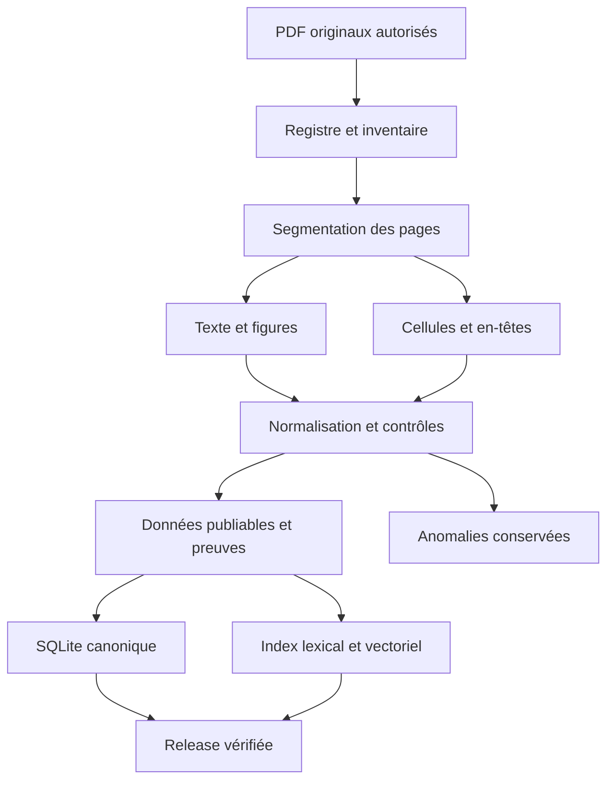
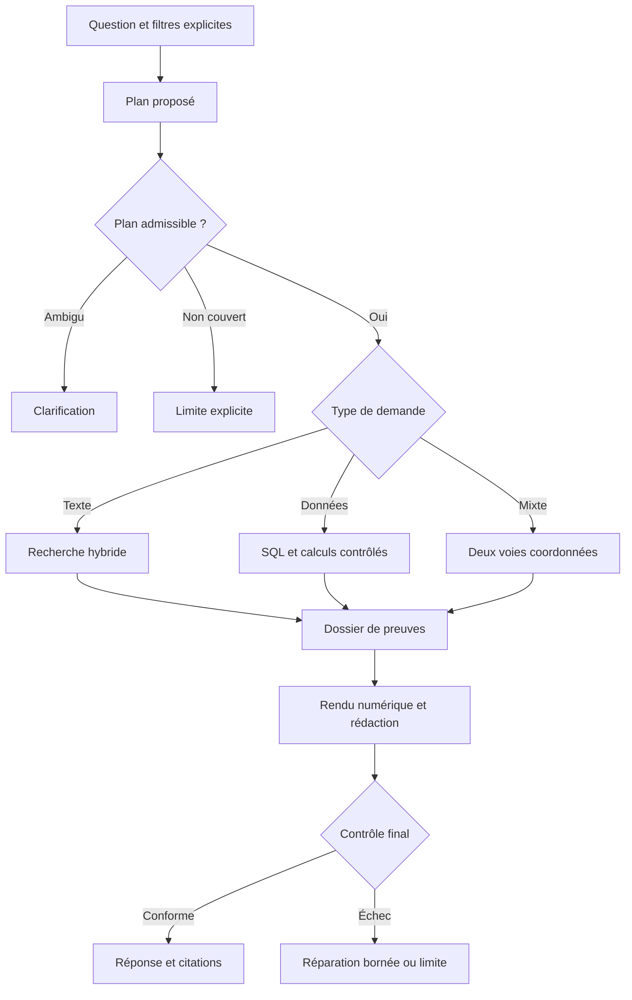

# Plan directeur d’implémentation — RAG DGRE

## 1. Objectif et périmètre

Construire un assistant documentaire et analytique permettant de consulter les deux annuaires DGRE, de retrouver des mesures, de comparer des observations compatibles et d’effectuer des calculs définis. La réponse doit préciser source, période, unité et qualité. Il contribue à l’analyse historique ; il n’effectue pas de prévision opérationnelle ni de décision automatique de gestion d’ouvrage.

Corpus autorisé : les deux PDF originaux. Annuaire hydrologique : 145 pages dans l’exemplaire analysé ; pluviométrique : 242. Les empreintes sont fournies dans `configuration/corpus_expected.json` pour vérifier l’identité, sans remplacer l’inventaire. Un fichier différent est une nouvelle version à examiner.

Les plans, prompts, tests et conversations sont exclus de l’index métier. Les connaissances pré-entraînées du LLM ne servent pas à compléter les observations absentes. Les méthodes de calcul sont des règles logicielles explicites, dont les entrées sont sourcées.

## 2. Méthode de développement retenue

Une seule phase active. L’agent connaît toute l’architecture, réalise le périmètre de la phase autorisée, vérifie son intégration avec les précédentes puis produit un rapport et s’arrête. Il ne réclame pas une approbation à chaque fichier édité. La validation de passage est une décision de suivi du projet, distincte d’une validation scientifique des données.

Les défauts internes à une phase doivent être corrigés avant son rapport final dans la mesure des moyens disponibles. Si une ambiguïté de source nécessite une expertise humaine, la déclarer et isoler les données concernées. Un composant indépendant peut être développé pendant la phase si cela sert son livrable, mais aucune phase suivante ne doit être déclarée réalisée par anticipation.

Le plan comporte des points d’intégration précoces : après P05, valeur publiée et page source ; après P07, calcul et entrées ; après P09, réponse complète contrôlée ; après P10, parcours Streamlit. L’intégration finale ne doit pas être la première fois que les modules échangent.

## 3. Architecture hors ligne

Brut immuable, candidats séparés, publication contrôlée. Une release contient base et index cohérents. L’ingestion ne s’exécute pas à chaque ouverture de Streamlit. Les images de pages sont générées à la demande et mises en cache par empreinte, page, résolution et rotation.

## 4. Architecture d’une question

Le reranker s’applique aux passages documentaires ; il ne juge pas la validité d’une opération arithmétique. Les résultats SQL ne retournent pas dans une nouvelle recherche sémantique sans raison. Chaque sous-question d’une demande mixte possède un résultat ou un statut ; une comparaison dépend de ses deux opérandes.

## 5. Décisions techniques

| Domaine | Décision |
|---|---|
| Application | Python modulaire ; Streamlit comme interface, moteur métier indépendant. |
| Source numérique | SQLite, décimaux canoniques et calcul Decimal. |
| Sources documentaires | Texte structuré, lexical FTS5 et vecteurs locaux. |
| Extraction | Native et géométrique, extracteur de structure en complément, OCR ciblé. |
| Modèles | Adaptateurs configurables ; choix et test selon RAM/VRAM réellement disponibles. |
| Orchestration | États explicites en Python ; LangGraph facultatif, pas une exigence de robustesse. |
| Dépendances | Environnement virtuel, versions verrouillées et API officielles vérifiées. |
| Déploiement | Usage local Windows prioritaire, aucun déploiement public demandé. |
| Qualité | Tests par module, par jonction et de bout en bout, annotations liées aux PDF. |

Le schéma SQL fourni est un socle. Les validations applicatives restent obligatoires : dates véritables, unités, bornes de pages et rectangles, preuves, conventions des symboles et cohérence des références. Les métadonnées géographiques et caractéristiques de stations doivent devenir des observations ou relations sourcées selon leur nature, pas des champs libres non traçables.

## 6. Découpage P00–P12

| Phase | Dépendances | Sortie vérifiable | Point de contrôle |
|---|---|---|---|
| P00 Environnement | Aucune | Diagnostic Windows, dépôt, PDF, matériel, décisions | Emplacements exacts ; aucune modification existante perdue. |
| P01 Contrats | P00 | Paquet, CLI, schémas, configuration, contrats UI | Types stricts et erreurs testés ; modèles non disponibles signalés. |
| P02 Inventaire | P01 | Toutes les pages et familles ; pilote représentatif | Numérotation et géométrie vérifiées. |
| P03 Extraction pilote | P02 | Cellules, tableaux et preuves du pilote | Aucun mélange station/résumé dans les blocs acceptés. |
| P04 Normalisation | P03 | Dates, symboles, unités, entités, contrôles | Anomalies bloquantes exclues des calculs. |
| P05 Base et release | P04 | Migration, provenance, sélection canonique | Idempotence, intégrité et lecture d’une valeur avec sa page. |
| P06 Recherche | P05 | Lexical, vecteurs, fusion, rappel mesuré | Évaluation sur passages annotés ; mode dégradé visible. |
| P07 Calculs | P05 | Fonctions Decimal et dérivations | Opérations et couverture correctes, même sans LLM. |
| P08 Planification | P06, P07 | Plans validés, ambiguïtés, routes mixtes | Choix d’entités et de périodes testés. |
| P09 Réponses | P08 | Preuves, génération, validation, contrats de vue | Chiffres et faits non soutenus bloqués après rédaction. |
| P10 Interface et extension | P09 | Cinq espaces Streamlit, corpus entier traité | Sources ouvrables, filtres cohérents, couverture exacte. |
| P11 Acceptation | P10 | Tests réservés, tests UI, corrections | Rapports avec résultats réellement observés. |
| P12 Livraison Windows | P11 | Installation, lancement, sauvegarde, documentation | Démarrage reproductible et limitations documentées. |

P06 et P07 sont conceptuellement indépendantes après P05, mais restent effectuées successivement dans ce mode de suivi. Un pilote de 15–25 pages doit couvrir les familles, puis être étendu si une nouvelle famille apparaît. Il n’est pas représentatif par son seul nombre de pages.

## 7. Extraction : risques spécifiques et traitement

La page pluviométrique PDF 50 contient quatre tableaux : isoler les régions avant de reconstruire les valeurs. La fiche hydrologique PDF 18 contient débit journalier, instantané, record historique et étalonnage : séparer ces objets. Ces exemples doivent être revérifiés par l’agent sur les originaux, pas seulement recopiés depuis le plan.

Le calendrier principal est septembre 2022–août 2023. Les tableaux historiques restent interrogeables sur leurs années propres. Un en-tête « 2022-2023 » n’est pas appliqué à un événement daté de 2012.

Ne pas transformer un tiret en zéro par convention supposée. Conserver le symbole et l’interprétation avec sa preuve. Les sommes peuvent alerter, pas prouver seules une convention. Le nombre de stations annoncé par un document ne constitue pas le nombre de séries complètes ingérées.

Enregistrer page PDF et imprimée, coordonnées de cellule, en-têtes, code source, unité et méthode de validation. Les blocs parents qui s’étendent sur plusieurs pages doivent être représentés sans inventer une seule grande bounding box inter-page.

Les courbes d’étalonnage, événements de crue et séries ponctuelles nécessitent des types distincts. La V1 peut restituer une courbe comme tableau sourcé ; interpoler une mesure nouvelle exige une méthode séparée et ne fait pas partie de la V1.

## 8. Couverture, contradictions et calculs

La sélection canonique utilise entité, indicateur, période, granularité, unité et référence. Un doublon de publication ne se somme pas deux fois. Un désaccord persistant reste un conflit ; aucune priorité aveugle à l’un des deux annuaires.

Une valeur annuelle publiée peut être citée quand sa propre extraction est validée, même si la série quotidienne n’est pas entièrement interprétable. Elle reste étiquetée « publiée », sans prétendre à une recomposition exacte.

Une moyenne de débits mensuels doit être pondérée par le nombre de jours et contrôlée par couverture. Une somme de pluies entre stations ne représente pas une pluie régionale. Un classement exige l’ensemble des observations admissibles, pas les meilleurs passages vectoriels.

Pour les changements de référence ou de période, demander une clarification ou présenter une comparaison explicitement limitée. Toute formule possède unité, préconditions, règle de couverture et arrondi. Une erreur source n’est jamais corrigée silencieusement.

## 9. Règles de Windows et reproductibilité

Racine métier : `C:\Users\SIGMA IT\Documents\RAG_DGRE`. Utiliser pathlib dans le code, des chemins relatifs au projet dans les configurations et des arguments correctement cités dans PowerShell. Ne pas coder le nom de l’utilisateur dans les modules.

Créer `.venv` après diagnostic. Préférer les exécutables explicites `.\.venv\Scripts\python.exe` pour lancer CLI, tests et Streamlit ; cela évite de dépendre de l’activation PowerShell. Ne pas changer globalement la politique d’exécution pour contourner un problème d’activation. Tous les chemins comportant des espaces doivent être testés.

Lors de P12, l’agent produit `scripts\run_app.ps1` et `scripts\doctor.ps1`. Ils se placent à la racine via `$PSScriptRoot`, vérifient les prérequis et échouent clairement. Ils n’installent pas silencieusement des logiciels globaux ni ne réingèrent les PDF au démarrage.

Ne pas choisir une version de Python ou de modèle en devinant : vérifier compatibilité et disponibilité. Un LLM indisponible ne bloque pas la lecture SQL et l’exploration de sources déjà publiées ; l’assistant textuel indique son indisponibilité.

Les prompts, formules, index, modèles et paramètres ont des versions dans chaque rapport. Un cache de réponse comprend la release et le contexte explicite. Un changement de release invalide les données mises en cache ; une conversation ancienne conserve sa release d’origine ou est signalée comme issue d’une version précédente.

## 10. Definition of Done et reste à faire

Chaque phase produit `reports/Pxx_report.md`, met à jour `docs/PROGRESS.md`, `docs/DECISIONS.md` et `docs/BLOCKERS.md`, et cite les fichiers/test outputs utiles. Les décisions de l’utilisateur sont enregistrées seulement après sa réponse réelle.

Le statut d’une phase est à faire, en cours, réalisée à examiner, acceptée pour la suite, ou bloquée. Réussite logicielle et validation métier des mesures sont suivies séparément. Aucun résultat de test n’est inventé pour passer une phase.

La livraison est complète seulement si toutes les fonctions obligatoires sont implémentées, les tests critiques réussissent, toutes les pages ont un état, les sources sont ouvrables, l’installation Windows est vérifiée sur l’environnement disponible et les limites sont visibles. Une couverture partielle est livrable comme telle, jamais présentée comme exhaustive.

## 11. Risques et décisions conditionnelles

| Risque | Signal observable | Réponse |
|---|---|---|
| PDF lisible mais ordre textuel faux | Valeurs décalées entre tableaux | Extraction géométrique et comparaison visuelle. |
| Référence climatique ambiguë | Période ou nombre d’années absents | Baseline inconnue ; pas de calcul injustifié. |
| Modèle trop lent pour le PC | Latence mesurée et mémoire insuffisante | Modèle/configuration alternatifs testés ; conserver moteur déterministe. |
| App relance les calculs à chaque clic | Doublons et latence lors des reruns | Clés de requête, état de session et cache versionné. |
| Réponse partielle masquée | Sous-question sans preuve | Statut par sous-question et limite explicite. |
| Données en quarantaine trop nombreuses | Couverture utile faible | Corriger familles d’extraction ; ne pas compenser par le LLM. |
| Ancienne release mélangée | Hash/version différents | Refus d’exécution et reconstruction cohérente. |

L’objectif est une application vérifiable, dont chaque composant dispose de preuves de fonctionnement et dont l’utilisateur voit les limites pertinentes.
