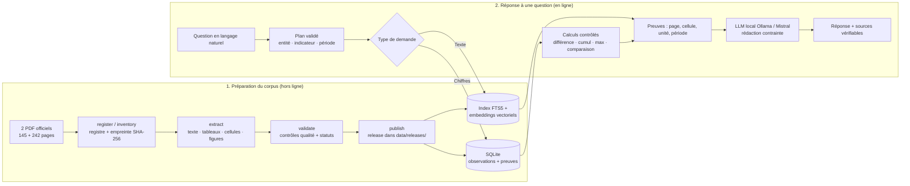
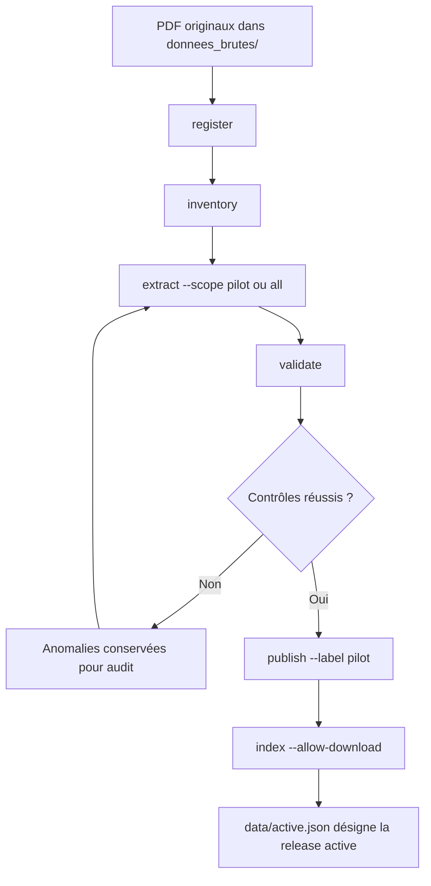
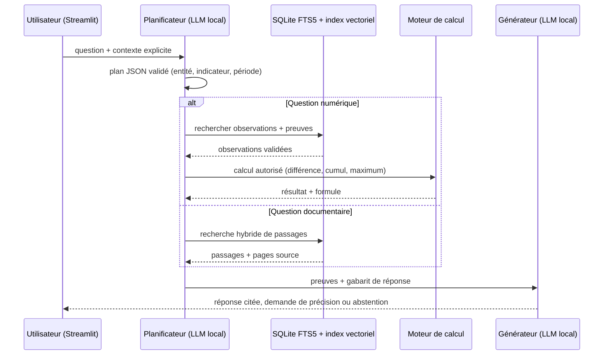

# DGRE — Assistant RAG des annuaires

Application Windows locale pour consulter les deux annuaires 2022–2023 : recherche documentaire, observations structurées, calculs contrôlés et ouverture des preuves PDF.

## C'est quoi ce projet ? (en simple)

Cet outil est un **assistant RAG** (*Retrieval-Augmented Generation*) qui répond à des questions en langage naturel sur **deux annuaires officiels tunisiens 2022–2023** :

1. **Annuaire hydraulique** — 145 pages : débits des cours d'eau, niveaux des barrages, crues historiques.
2. **Annuaire pluviométrique** — 242 pages : pluies journalières et mensuelles des stations.

Au lieu de feuilleter **387 pages de PDF**, on pose une question (« Quel est le maximum journalier de pluie à Aïn Draham en 2022–2023 ? ») et l'application renvoie une réponse **avec les pages source** qui permettent de vérifier le chiffre.

**Le point clé : le modèle de langage n'invente pas les nombres.** Le logiciel extrait les tableaux, valide les valeurs, les stocke dans SQLite, effectue les calculs avec des règles déterministes, puis le modèle local (Ollama / Mistral) rédige une réponse contrainte aux preuves trouvées. Si la donnée est absente ou ambiguë, l'assistant le dit explicitement au lieu de deviner.

### RAG = Retrieve · Augment · Generate

- **Retrieve** — retrouver les bons passages grâce à deux index : recherche lexicale **SQLite FTS5 (BM25)** et recherche sémantique par **embeddings locaux** (FastEmbed / ONNX).
- **Augment** — joindre les observations structurées et leurs preuves : document, page PDF, page imprimée, rectangle du tableau, cellule, unité et période.
- **Generate** — le LLM local rédige à partir de **ces seules preuves**, avec un contrôle avant et après génération (nombres, unités, périodes, entités).

---

## Schéma 1 — Architecture globale



## Schéma 2 — Pipeline de préparation des données



Les trois états des données sont **brut** (tel qu'extrait), **candidat** (valeur normalisée avec indicateur, période, unité) et **publié** (après contrôles, avec preuves). Un tiret n'est jamais converti en zéro sans preuve de la convention.

## Schéma 3 — Le déroulement d'une question



---

## Lancer l’application

Depuis la racine du projet dans PowerShell :

```powershell
.\.venv\Scripts\python.exe -m streamlit run app/streamlit_app.py
```

Ouvrir **http://127.0.0.1:8501**. Le serveur est limité à l’ordinateur local. `scripts/run_app.ps1` propose le même lancement si l’exécution de scripts PowerShell est autorisée. Aucune modification globale de la politique PowerShell n’est nécessaire.

L’interface comporte seulement **Assistant** et **Sources**. Consultation, comparaison, disponibilité des données, tableaux, graphiques et téléchargements passent par la conversation. L’ouverture de l’application ne relance ni extraction ni téléchargement de modèles.

Exemples : « Montre les pluies mensuelles à Aïn Draham en 2022–2023 », « Compare les capacités des barrages Sidi Salem et Mellègue », « Quelles données sont disponibles ? ». Après deux valeurs, poursuivez avec « Compare les deux », puis « Fais un graphique » ou « Télécharge le tableau ». Les précisions de station et de période sont demandées dans le chat. Sources permet d’ouvrir les pages justificatives et de revenir à la conversation.

## Données et qualité

Seuls les deux originaux dans `donnees_brutes/` sont enregistrés. Les 387 pages sont inventoriées. Le texte et les tableaux bruts sont conservés ; les familles de grilles prises en charge produisent des observations avec rectangles et preuves. Les valeurs numériques correctement attribuées sont sélectionnées après les contrôles applicatifs ; ce statut ne constitue pas une validation scientifique humaine.

**La couverture numérique est partielle.** Certains tableaux restent bruts et de nombreux symboles restent indéterminés. Un tiret n’est pas converti en zéro. Les totaux publiés peuvent être consultés indépendamment de la possibilité de recalculer leur série. Les lacunes, contradictions et incohérences détectées sont visibles. Consulter [le rapport de livraison](reports/DELIVERY.md) pour l’état mesuré.

L’assistant formule les valeurs et comparaisons à partir des observations et des tableaux de synthèse avec leurs sources. Il exploite aussi les notices de barrages, les nombres de jours de pluie et les caractéristiques des crues. Pour les questions documentaires, le modèle local peut rédiger une explication contrôlée contre les passages retrouvés ; en cas d’échec du contrôle, un extrait accompagné d’une limite peut être présenté. Ces contrôles ne constituent pas une certification scientifique.

## Audit des 230 questions

Le [rapport final](reports/question_audits/controle_final/rapport.html) contient chaque question, sa réponse, ses sources et les critères de vérification issus des PDF. Le [bilan des corrections](reports/question_audits/BILAN.md) distingue les réponses obtenues des demandes de précision et des informations non établies.

```powershell
.\scripts\auditer_questions.ps1 -Nom mon_audit
```

Voir le [guide de l’audit](evaluation/LIRE_MOI_AUDIT.md) pour importer une liste, reprendre une exécution et interpréter les résultats. Après une nouvelle publication du corpus, reconstruire les synthèses avec `.\.venv\Scripts\python.exe scripts/build_reference_catalog.py` avant de refaire l’audit.

## Configuration locale

`config/app.yaml` définit les chemins relatifs, le fournisseur Ollama local, le modèle Mistral installé et le modèle multilingue d’embeddings. Les modèles sont configurables ; aucune clé API n’est nécessaire pour cette configuration. Les embeddings sont exécutés localement avec ONNX/FastEmbed.

Ollama doit être actif pour les questions nécessitant une planification par modèle et la sélection documentaire assistée. Les consultations structurées, les comparaisons et les sources restent utilisables sans LLM. Le diagnostic vérifie la présence du modèle, sans prétendre que cette présence garantit la qualité de ses réponses.

```powershell
.\.venv\Scripts\python.exe -m dgre_rag.cli doctor
```

## Installer sur un autre poste

Version testée : Python 3.11.9, Windows, chemins contenant des espaces. Copier le code, la configuration et les deux PDF ; les chemins des modèles et données doivent rester conformes à la configuration.

```powershell
py -3.11 -m venv .venv
.\.venv\Scripts\python.exe -m pip install -r requirements.lock.txt
.\.venv\Scripts\python.exe -m pip install -e . --no-deps
```

L’installation des dépendances et le premier téléchargement du modèle d’embeddings nécessitent un accès réseau. La consultation utilise ensuite les fichiers locaux. Ollama et le modèle Mistral sont des prérequis distincts, déjà présents sur le poste de développement ; leur installation n’est pas effectuée silencieusement par l’application.

## Préparer ou reconstruire les données

```powershell
.\.venv\Scripts\python.exe -m dgre_rag.cli register
.\.venv\Scripts\python.exe -m dgre_rag.cli inventory
.\.venv\Scripts\python.exe -m dgre_rag.cli extract --scope pilot
.\.venv\Scripts\python.exe -m dgre_rag.cli validate
.\.venv\Scripts\python.exe -m dgre_rag.cli publish --label pilot
.\.venv\Scripts\python.exe -m dgre_rag.cli index --allow-download
```

Pour le corpus entier, remplacer `--scope pilot` par `--scope all`, puis valider, publier et indexer. L’option `--allow-download` est réservée à la préparation ; l’interface ne télécharge aucun modèle. Un run achevé du même extracteur et du même corpus est réutilisé. Un run interrompu est conservé et un nouveau run distinct est créé.

Les sources, caches de lecture dans `tmp`, tests et rapports ne sont jamais ajoutés automatiquement au corpus. Les données de chaque run sont dans `data/runs/`. Une release dans `data/releases/` est indépendante des suivantes ; `data/active.json` désigne la release active. Ne pas modifier les bases publiées manuellement.

## Questions et contrôles

```powershell
.\.venv\Scripts\python.exe -m dgre_rag.cli ask "Quel est le maximum journalier de Pont de Bizerte en 2022-2023 ?"
.\.venv\Scripts\python.exe -m dgre_rag.cli coverage
.\.venv\Scripts\python.exe -m pytest -q
.\.venv\Scripts\python.exe scripts/build_evaluation.py
.\.venv\Scripts\python.exe -m dgre_rag.cli evaluate --split dev
.\.venv\Scripts\python.exe -m dgre_rag.cli evaluate --split test
```

Les résultats d’évaluation distinguent recherche, réponses déterministes et limites. Le score documentaire mesure la présence de la page attendue dans les résultats ; il ne certifie pas à lui seul une synthèse rédigée. Les annotations initiales viennent d’une lecture par agent, sans validation humaine déclarée.

Le jeu contient 120 questions de développement, utilisées pour les réglages, et 24 questions numériques réservées. Les résultats mesurés sont dans `reports/evaluation_dev.json` et `reports/evaluation_test.json`. Pour régénérer le bilan depuis ces résultats et le dernier rapport pytest : `python scripts/write_delivery_report.py` avec le Python de `.venv`.

## Sauvegarde et restauration

```powershell
.\.venv\Scripts\python.exe -m dgre_rag.cli backup
.\.venv\Scripts\python.exe -m dgre_rag.cli restore <release_id>
.\.venv\Scripts\python.exe -m dgre_rag.cli rebuild-index
```

`backup` copie la release dans `data/backups/`. `restore` active une release déjà présente dans `data/releases/` après vérification de son empreinte et de son intégrité. Pour une sauvegarde externe, conserver également les originaux, le registre et les modèles locaux ; le répertoire des releases ne contient pas une seconde copie des PDF. La restauration d’un dossier de sauvegarde externe vers `data/releases/` relève de la copie de fichiers documentée, puis de la commande `restore`.

## Organisation et références

- [Construction et lancement avec Docker](docs/DOCKER.md)

- [Plan d’implémentation](docs/PLAN_IMPLEMENTATION_COMPLET.md)
- [Progression](docs/PROGRESS.md)
- [Décisions](docs/DECISIONS.md)
- [Limites et blocages](docs/BLOCKERS.md)
- [Guide utilisateur](docs/GUIDE_UTILISATEUR.md)

Références techniques consultées pour les APIs utilisées : [PyMuPDF](https://pymupdf.readthedocs.io/en/latest/page.html), [Streamlit](https://docs.streamlit.io/develop/concepts/multipage-apps/page-and-navigation), [FastEmbed](https://qdrant.github.io/fastembed/), [sorties structurées Ollama](https://docs.ollama.com/capabilities/structured-outputs). Elles ne font pas partie de l’index métier.

## GitHub repository

This repository contains the source code, configuration, tests, scripts and documentation. Generated data (data/, donnees_brutes/, tmp/, livrables/) and large audit reports stay local and are not versioned; rebuild them with the commands above.

